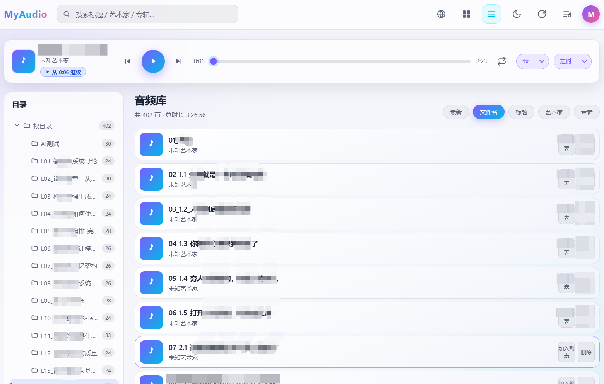

# MyAudio · A Personal Audio Streaming Service

[简体中文](README.md) · **English**

A lightweight private audio streaming service built with **Go (Gin) + SQLite**. One self-contained binary, no external services, low memory usage. Play and manage local MP3, WAV, FLAC, OGG and M4A files from a browser on a phone or a computer.

## Screenshots

<table>
  <tr>
    <td align="center"><a href="prototype/images/1.png"></a><br>Desktop</td>
    <td align="center"><a href="prototype/images/3.jpg"></a><br>Mobile</td>
    <td align="center"><a href="prototype/images/2.png"></a><br>Login</td>
  </tr>
</table>

## Use cases

You've got a small cloud VPS (one of those ¥69–99/year 1-core/1-GB promo boxes from Tencent, Alibaba or Huawei), an old laptop gathering dust, or a NAS, with a disk full of audio: boxed audiobook sets, recorded lectures, podcast archives, music collected over the years. Listening on the computer ties you to a desk; copying everything to a phone never fits; a cloud drive makes you download each file before it plays. MyAudio is for exactly that — the files are yours, open a browser and press play, no need to rearrange them into whatever shape a platform expects.

Playback position lives on the server, not in the browser. Stop at 12:36 on the computer at night and the phone picks up at 12:36 on the morning commute — tap "Resume" and carry on. Lock-screen and Bluetooth controls work; at bedtime you can change the speed or set a sleep timer. Switching devices or clearing browser data loses nothing.

Drop files into `music_dir` keeping the folder layout you already have. The tree on the left mirrors the folders on disk, however you organised them — by album, course, year or language. Upload something new, hit "Scan", and it shows up in the library; title, artist and embedded cover art are read from tags where available. No playlists to build first, no renaming files just to get the order right.

It stays private: one password, the server listens on `127.0.0.1` by default, and public access goes through nginx with HTTPS. Audio, covers and listening history stay on your disk and in SQLite — no accounts, no third-party sync. Deployment is one binary and one config file; no Docker, no separate database, no transcoding. A modest machine can run it indefinitely, and once `systemd` is set up you can mostly forget about it.

What it doesn't do, plainly: no multiple users, no share links, no transcoding, no online metadata lookup. If that's what you need, a cloud drive or a full music server is a better fit.

## Features

- **Library scanning**: recursively scans the local audio directory, extracts title/artist/album and embedded cover art; scans on startup, on a timer, or manually from the page; incremental updates keyed by path + modification time
- **Folder tree**: two-column layout; the left tree is built from each file's relative directory (missing intermediate levels are filled in), the current folder is highlighted in blue with a track count that includes subfolders; selection and expansion state survive reloads, everything expanded on first visit; below 900px the sidebar becomes a drawer
- **Streaming playback**: HTTP Range support, seekable progress bar, lock-screen / Bluetooth controls on phones (Media Session API)
- **Server-side playback position**: per-track progress persisted in SQLite, **restored on any device or browser after login** with a one-click "Resume"; throttled sync every 3 seconds while playing, `sendBeacon` fallback on pause / tab hide / page close, cleared when a track finishes or is deleted
- **Browse and search**: cover grid / list views, instant search by title/artist/album; sorting by filename/title/artist/album/latest (filename by default) and pagination
- **Bilingual UI**: dependency-free i18n engine, one-click switch between Simplified Chinese and English on the login page and in the app, preference stored locally, applied immediately
- **Playlists**: create / rename / delete, add / remove tracks, sequential / loop / shuffle modes
- **Management**: delete library entries (optionally the files on disk too); stale entries are cleaned up automatically
- **Security**: single-user password login (bcrypt hash), session cookie, per-IP login rate limiting (5 failed attempts locks for 10 minutes), security response headers
- **Easy deployment**: pure Go (the SQLite driver needs no CGO), frontend compiled into the binary with `embed`, one file is enough to run, systemd unit included

## Tech stack

| Layer | Choice |
|---|---|
| HTTP framework | Gin |
| Database | SQLite (`modernc.org/sqlite`, pure Go driver, WAL mode, no CGO) |
| Tag parsing | `dhowden/tag` (ID3v1/v2, FLAC, OGG, etc.; extracts embedded cover art) |
| Passwords | `golang.org/x/crypto/bcrypt` |
| Frontend | Plain HTML/CSS/JS, home-grown dependency-free i18n (`i18n.js` + `locales/` dictionaries), embedded via `embed.FS`, no build step, no CDN |
| Config | YAML (`gopkg.in/yaml.v3`) |

## Project layout

```
MyAudio/
├── cmd/myaudio/main.go        # entry point: wiring, server startup, graceful shutdown
├── internal/
│   ├── config/                # config loading (generates a random password on first run)
│   ├── model/                 # entities and query objects
│   ├── store/                 # SQLite migrations, CRUD, search
│   ├── scanner/               # directory scanning, tag/cover parsing, WAV duration, incremental sync
│   ├── auth/                  # bcrypt login, sessions, rate-limit middleware
│   └── api/                   # Gin routes and handlers (streaming / covers / playlists)
├── web/                       # frontend assets (embedded into the binary)
│   ├── embed.go
│   ├── index.html  login.html  app.js  style.css
│   ├── i18n.js                # lightweight i18n engine (t() / setLang / langchange event)
│   └── locales/               # dictionaries: zh-CN.js, en.js
├── deploy/myaudio.service     # systemd unit
├── scripts/release.sh         # release packaging (includes a prebuilt binary)
├── dist/                      # prebuilt release archives (*.tar.gz) and .sha256 checksums
├── run.sh                     # one-command build / start / stop / management script
├── config.example.yaml        # example configuration
└── go.mod / go.sum
```

## Quick start

**Defaults at a glance:**

| Setting | Default |
|---|---|
| Service port (myaudio) | `8083`, bound to `127.0.0.1:8083` by default (localhost / reverse-proxy backend only) |
| Public port (nginx SSL proxy) | `18083`, forwarding to `127.0.0.1:8083` |
| Music directory | `./data/music` |
| Data directory (SQLite + covers) | `./data` |
| Initial password | A random 10-character password is generated when no config file exists (printed to the log); otherwise the configured `password` is used |
| Scan interval | `5m` |
| Session lifetime | `168h` (7 days) |
| Login protection | 5 consecutive failures lock the account for 10 minutes |

### 1. Build

Building from source requires **Go 1.26.0+** (the `go` directive in `go.mod`; older versions cannot resolve the dependencies).

```bash
CGO_ENABLED=0 go build -trimpath -ldflags="-s -w" -o myaudio ./cmd/myaudio
```

The resulting `myaudio` is a statically linked single binary (~25 MB) that can be copied straight to a Linux machine.

> **Running without Go**: if no Go toolchain is found, `./run.sh build` and `./run.sh start` verify and extract the prebuilt release archive for the current platform from `dist/` (produced by `scripts/release.sh`) — no network install needed. You can also unpack it manually:
>
> ```bash
> (cd dist && sha256sum -c myaudio_v1.0.1_linux_amd64.tar.gz.sha256)  # verify
> tar -xzf dist/myaudio_v1.0.1_linux_amd64.tar.gz
> cp myaudio_v1.0.1_linux_amd64/myaudio ./myaudio && chmod +x ./myaudio
> ```
>
> The `linux_amd64` part must match your platform; see Troubleshooting.

### 2. Configure

Copy the example config:

```bash
cp config.example.yaml config.yaml
```

```yaml
listen: "127.0.0.1:8083"     # listen address, default port 8083; use loopback behind a reverse proxy
music_dir: "./data/music"    # audio directory (scanned recursively)
data_dir: "./data"           # SQLite and cover cache directory
password: "change-me-please" # access password; converted to password_hash after first start
scan_interval: 5m            # periodic scan interval, 0 disables it
session_ttl: 168h            # session lifetime (7 days)
max_upload_mb: 100           # reserved: per-file limit for future web uploads
```

Configuration reference:

| Field | Default | Description |
|---|---|---|
| `listen` | `127.0.0.1:8083` | Listen address, default port `8083`. `127.0.0.1:8083` is reachable only locally / from the reverse proxy (recommended); `:8083` (same as `0.0.0.0:8083`) listens on all interfaces — **use this only for direct LAN access from a phone without a proxy**. With an nginx SSL proxy the public port is still `18083` |
| `music_dir` | `./data/music` | Audio directory, scanned recursively; supports `.mp3/.wav/.flac/.ogg/.m4a` |
| `data_dir` | `./data` | SQLite database and cover cache directory |
| `password` / `password_hash` | — | Access password, choose one; `password_hash` (bcrypt) takes precedence |
| `scan_interval` | `5m` | Periodic scan interval; set to `0` to disable it (manual scans from the page still work) |
| `session_ttl` | `168h` (7 days) | Login session lifetime |
| `max_upload_mb` | `100` | Reserved for a future web upload feature |

### 3. Initial password and first login

There are two ways to set the password:

**Option A: run without `config.yaml` (random password generated)**

On first start the program writes a default config and generates a **random 10-character initial password**, printed to stdout (or to the journal under systemd), for example:

```
[config] 未发现配置文件，已生成默认配置: config.yaml
[config] 初始访问密码: aB3xK9pQ2Z （请尽快修改 config.yaml 中的 password 后重启）
```

These startup log lines are emitted in Chinese. They read: "no config file found, default config written" and "initial access password" (change `password` in `config.yaml` and restart).

**Option B: set `password` in `config.yaml` yourself**

The plaintext password you chose is used.

> Either way, after the first start the plaintext `password` is replaced by a bcrypt hash in `password_hash` and the plaintext field is cleared (config file permissions `0600`). From then on only the hash is checked at login.

**Viewing / changing / resetting the password:**

```bash
# Show the generated initial password (terminal when running directly, journal under systemd)
journalctl -u myaudio | grep "初始访问密码"

# With the helper script (recommended): reset the password and restart automatically, see 4.0
./run.sh reset-password

# Manual method for systemd installs: edit config.yaml, set a new plaintext password
# and remove the old password_hash line so the program regenerates the hash
#   password: "new-password"
#   # password_hash: ...   <- remove this line
sudo systemctl restart myaudio
```

The `grep` pattern above is the Chinese log message shown in Option A; keep it as-is.

### 4. Run

`-config` sets the config file path; it defaults to `config.yaml` in the current directory. You can run in the foreground for debugging or as a background service.

#### 4.0 Helper script (recommended)

`run.sh` in the project root wraps building, the usual start/stop commands and password resets, so you never have to manage PIDs by hand:

```bash
chmod +x run.sh          # make it executable once

./run.sh build           # build the single binary myaudio
./run.sh start           # start in the background (builds a missing binary, logs to myaudio.log)
./run.sh status          # show PID, memory usage, uptime and listening port
./run.sh health          # call the /healthz health check
./run.sh logs            # follow the log (Ctrl+C to exit), optionally with a line count: ./run.sh logs 200
./run.sh restart         # restart (to apply config.yaml changes)
./run.sh reset-password  # reset the access password (random, restarts automatically)
./run.sh passwd 'new-password'  # same, but with a password you choose
./run.sh stop            # graceful stop (SIGTERM, waits up to 10s)
./run.sh force-stop      # force kill (SIGKILL, avoid unless necessary)
./run.sh foreground      # run in the foreground (debugging, Ctrl+C to stop)
./run.sh help            # list all commands
```

**One-command password reset** (when you forgot the password, or a broken `password_hash` prevents login):

```bash
./run.sh reset-password                  # generate and print a random 16-character password (shown once)
./run.sh reset-password 'MyNewP@ss'      # choose the password yourself
CONFIG=/opt/myaudio/test.yaml ./run.sh reset-password   # works with multiple instances too
```

`reset-password` (alias `passwd`) only replaces the `password` / `password_hash` lines in `config.yaml`; every other setting (listen address, music directory, scan interval, session lifetime, ...) and all comments are left untouched. Before writing it creates a `config.yaml.bak` backup in the same directory; both files are `0600`, so you can roll back or compare. If the service is running, the command gracefully restarts it to apply the new password, which also invalidates existing login sessions; if it is not running, the change takes effect on the next `./run.sh start`. Quote passwords containing spaces or special characters as usual for your shell — the script escapes them for YAML.

> On restart the program rewrites the config through its usual YAML serialisation: the plaintext `password` becomes a bcrypt hash in `password_hash`, the plaintext is cleared (so save the password printed in the terminal immediately), comments are lost, and field order / duration formatting are normalised. This is unrelated to the reset command; `.bak` keeps the original file intact.

#### 4.1 Check which build is running

Frontend assets are compiled into the binary with `embed`, so **any frontend change requires a rebuild and a restart** — replacing files under `web/` alone has no effect. To find out whether the running process is the latest build, call `/healthz`:

```bash
curl -s http://127.0.0.1:8083/healthz
# {"status":"ok","revision":"600766c07097","assets":"\"ee8378009e340a8d\""}
```

- `revision`: the Git commit used at build time (`vcs.revision`, injected by `go build`), first 12 characters
- `assets`: a content fingerprint of `style.css`; it changes whenever the frontend changes

If `revision` does not match the latest commit in the repository, the deployed binary is stale — just rebuild:

```bash
./run.sh build && ./run.sh restart
```

#### 4.2 Frontend cache policy

The server handles three kinds of responses differently, so an upgrade never leaves the browser showing an old layout from cached CSS/JS:

| Resource | Response headers | Reason |
|---|---|---|
| HTML (`/`, `/login`) | `Cache-Control: no-store` | Page structure changes between versions; always fetch from the server |
| CSS/JS/locales | `Cache-Control: no-cache` + `ETag` | Revalidate on every request, `304` when unchanged |
| Static assets referenced by pages | `/style.css?v=<fingerprint>` | URL carries a content fingerprint; a changed file means a changed URL |

Because filenames have no hash, a long `max-age` is unsafe: a cached old stylesheet would keep the old layout after an upgrade. `no-cache` + `ETag` validation together with the `?v=` fingerprint in the HTML avoids stale caches without wasting bandwidth.

The script tracks the process through a PID file (`myaudio.pid` by default), recognises stale PIDs and refuses to start twice. Use environment variables to isolate multiple instances:

```bash
CONFIG=/opt/myaudio/test.yaml ./run.sh start   # PID/log files derived from the config name, no interference
```

The 4.1 / 4.2 sections below give the equivalent manual commands, useful for understanding what the script does or when it is not available.

#### 4.1 Foreground (debugging)

```bash
./myaudio -config config.yaml
```

Logs go straight to the terminal; `Ctrl+C` sends `SIGINT` to stop. Handy for checking the generated initial password and watching the first scan.

#### 4.2 Background (without systemd)

```bash
# Start: run in the background with nohup, append logs to myaudio.log
nohup ./myaudio -config config.yaml >> myaudio.log 2>&1 &

# Save the PID for later
echo $! > myaudio.pid
```

Everyday commands:

```bash
# Check status (PID and listening port)
ps -p "$(cat myaudio.pid)" -o pid,rss,cmd
ss -ltnp | grep 8083

# Follow the log
tail -f myaudio.log

# Stop: SIGTERM triggers a graceful exit (waits for in-flight requests, up to 8 seconds)
kill "$(cat myaudio.pid)"

# If the PID was not saved, stop by process name
pkill -f 'myaudio -config'

# Restart (stop, then start)
kill "$(cat myaudio.pid)" 2>/dev/null; sleep 1
nohup ./myaudio -config config.yaml >> myaudio.log 2>&1 & echo $! > myaudio.pid
```

> **Signals**: the program traps `SIGINT` (`Ctrl+C`) and `SIGTERM` (the default `kill` signal), stops accepting new connections and waits for in-flight requests for up to 8 seconds. `kill -9` (`SIGKILL`) kills it immediately — avoid unless necessary.

## systemd deployment (recommended)

```bash
# 1. Create a dedicated user and directories
sudo useradd -r -s /usr/sbin/nologin myaudio
sudo mkdir -p /opt/myaudio/data/music
sudo cp myaudio config.yaml /opt/myaudio/
sudo chown -R myaudio:myaudio /opt/myaudio

# 2. Install the service
sudo cp deploy/myaudio.service /etc/systemd/
sudo systemctl daemon-reload
sudo systemctl enable --now myaudio

# 3. Check status and logs (the random initial password is here too)
systemctl status myaudio
journalctl -u myaudio -f
```

Day-to-day management after installation:

```bash
sudo systemctl start myaudio      # start
sudo systemctl stop myaudio       # stop (SIGTERM graceful exit, TimeoutStopSec=10s)
sudo systemctl restart myaudio    # restart (to apply config.yaml changes)
sudo systemctl status myaudio     # status, PID and recent logs
sudo systemctl enable myaudio     # start on boot
sudo systemctl disable myaudio    # disable start on boot
journalctl -u myaudio -f          # follow the log
journalctl -u myaudio --since "1 hour ago"   # logs from the last hour
```

The unit is configured with automatic restart on failure (`Restart=on-failure`), a 128 MB memory limit, `NoNewPrivileges`, `ProtectSystem` and other hardening; only the data directory is writable.

> **Initial password under systemd**: if `/opt/myaudio/config.yaml` has no `password`/`password_hash`, find the generated password with `journalctl -u myaudio | grep "初始访问密码"` (the Chinese log message for "initial access password").
>
> **Firewall**: myaudio listens on loopback `127.0.0.1:8083` by default and is not exposed, so port 8083 needs no rule. Behind an nginx SSL proxy the public entry point is **18083**, and that is the only port to open:
>
> ```bash
> sudo ufw allow 18083/tcp     # ufw (public HTTPS entry point served by nginx)
> # or
> sudo firewall-cmd --add-port=18083/tcp --permanent && sudo firewall-cmd --reload   # firewalld
> ```
>
> Without a proxy, if you switch to `:8083` on all interfaces, open port 8083 instead.

## Frontend UI and local state

The frontend is plain HTML/CSS/JS with no build step and no framework. All user preferences live in the browser's `localStorage` (keys prefixed with `myaudio_`); clearing site data restores the defaults:

| Key | Value |
|---|---|
| `myaudio_lang` | UI language: `zh-CN` / `en` |
| `myaudio_theme` | Theme: `light` / `dark` |
| `myaudio_view` | View: `grid` (cover grid) / `list` |
| `myaudio_order` | Sort field, default `filename` |
| `myaudio_dir` | Currently selected relative directory (empty = root / all) |
| `myaudio_dir_expanded` | Array of expanded directory paths in the tree |
| `myaudio_mode` / `myaudio_speed` | Playback mode / playback speed |

> Playback progress and the "last played track" are **no longer stored in the browser** — they live on the server (see below). The old `myaudio_positions` / `myaudio_last_track` keys written by earlier versions are removed automatically when the new version loads.

**Folder tree**: `/api/dirs` returns a flat list of relative directories that contain tracks; `buildDirTree()` splits them on `/` and fills in intermediate levels to assemble the tree. A parent's count is the sum of its own tracks and those of all subdirectories. The selected item is highlighted in blue (distinct from the brand purple); on desktop the left pane stays visible while scrolling, and below 900px it becomes a drawer with a backdrop.

**Server-side playback position (cross-device sync)**: progress is stored in the SQLite `play_positions` table (`track_id` foreign key with cascading deletes, so deleting a track clears its position; capped at 200 rows, evicting the least recently updated). On startup the frontend fetches `GET /api/positions` once and caches it in memory; reads go through the cache, writes through `PUT /api/positions/:id`. While playing, sync is throttled to every 3 seconds, and on pause, tab hide (`visibilitychange`) or page close/refresh (`pagehide`) `navigator.sendBeacon` (falling back to a `keepalive` fetch) saves the final position so the request survives page unload. After a refresh or a login from another device, the last track and its position are restored (browser autoplay policies mean it won't start making sound on its own); clicking the resume badge in the player continues from there. Within 5 seconds of the start, or near the end, playback starts from the beginning.

**Internationalisation (i18n)**: `web/i18n.js` exposes a global `t(key, params)` plus `I18N.setLang` / `toggleLang`. Static text is bound with `data-i18n` (and `data-i18n-placeholder/title/aria-label/alt`), dynamic text calls `t()`; switching languages fires a `langchange` event that the app uses to rebuild dynamic DOM. Adding a string only requires editing `web/locales/zh-CN.js` and `web/locales/en.js` together.

> Because the frontend is compiled into the binary with `embed`, **changes under `web/` only take effect after `./run.sh build && ./run.sh restart` (or a fresh `go build` and restart)**; do a hard refresh in the browser (`Ctrl/Cmd + Shift + R`) afterwards to bypass the cache.

## License

MIT
