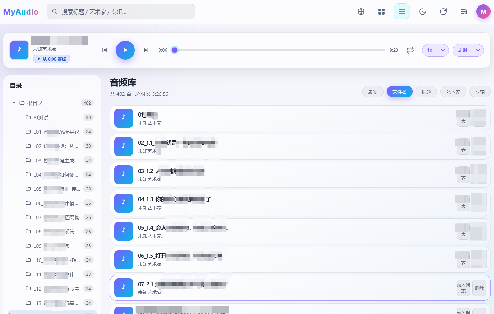

# MyAudio · 个人在线音频播放服务

基于 **Go (Gin) + SQLite** 的轻量级私人音频流媒体服务。单二进制部署、无外部依赖、内存占用低，支持手机/电脑浏览器在线播放与管理本地 MP3、WAV、FLAC、OGG、M4A 音频。

## 页面预览



## 使用场景

手里有一台小云服务器、闲置的旧笔记本，或者一台 NAS，硬盘里攒了不少音频：成套的有声书、网课录音、播客存档，还有这些年收集的音乐。放在电脑上只能坐下来听，拷到手机里又装不下，丢进网盘听还得先下载一遍。MyAudio 想解决的就是这件事——文件是自己的，打开浏览器就能听，不用先整理成某个平台要求的样子。

文件按原来的目录放进 `music_dir` 就好。磁盘上怎么分文件夹，页面左侧就长成什么样的目录树，按专辑、课程、年份、语种分都行；之后传了新文件，点一下「扫描」就进库，标题、艺术家和内嵌封面能读标签的会自动带上。不用先建歌单，也不用为了排序给文件改名。

播放进度记在服务器上，不在浏览器里。晚上用电脑听到 12:36，第二天通勤路上手机打开还是 12:36，点一下「续播」接着走；锁屏和蓝牙线控能用，睡前听可以调倍速、设定时关闭。换设备、清缓存都不会丢。

访问范围也只有自己：单用户密码登录，服务默认只监听 `127.0.0.1`，对外交给 nginx 的 HTTPS，音频、封面和播放记录都留在自己的磁盘和 SQLite 里，没有账号体系，也没有第三方同步。部署上是一个二进制加一个配置文件，不需要 Docker、额外的数据库服务或转码，普通小机器就能长期挂着；配好 `systemd` 之后基本不用管它。

不做的事也写清楚：没有多用户和分享链接，不转码，也不联网匹配曲库信息。如果需要的是这些，用现成的网盘或音乐服务器更合适。

## 特性

- **目录扫描入库**：递归扫描本地音频目录，自动解析标题/艺术家/专辑与内嵌封面；支持启动扫描、定时扫描、页面手动扫描，按路径+修改时间增量更新
- **目录树导航**：左右分栏布局，左侧依据音频相对目录生成可展开/折叠的层级树（自动补齐中间层级），蓝色高亮当前选中目录并显示各目录（含子目录）曲目数；选中目录与展开状态跨刷新记忆，首次进入默认全部展开；窄屏（≤900px）下侧边栏自动变为抽屉式
- **在线流播放**：支持 HTTP Range 请求，可拖动进度条、断点续播；手机锁屏/蓝牙线控（Media Session API）
- **播放位置记忆（服务器端）**：按曲目分别记忆播放进度并持久化到服务器 SQLite，**任意设备/浏览器登录后都能同步恢复**上次曲目与位置并提供「一键续播」；播放中节流（每 3 秒）同步，暂停/切后台/关闭页面时通过 `sendBeacon` 兜底保存，完整播完或删除曲目时自动清除
- **浏览与搜索**：封面网格 / 列表两种视图，按标题/艺术家/专辑关键词即时搜索；支持文件名/标题/艺术家/专辑/最新多种排序（默认按文件名）与分页
- **中英文双语**：内置零依赖 i18n 引擎，登录页与主应用一键切换简体中文 / English，语言偏好本地持久化，切换即时生效
- **播放列表**：创建/重命名/删除播放列表，曲目加入/移除，连续播放、列表循环、随机播放三种模式
- **管理**：删除库记录，可选同时删除磁盘文件；自动清理已失效的曲目记录
- **安全**：单用户密码登录（bcrypt 哈希）、会话 Cookie、按 IP 登录限速（连续失败 5 次锁定 10 分钟）、安全响应头
- **易部署**：纯 Go 实现（SQLite 驱动无 CGO），前端通过 `embed` 编译进二进制，单个文件即可运行，附 systemd 单元

## 技术栈

| 层 | 选型 |
|---|---|
| HTTP 框架 | Gin |
| 数据库 | SQLite（`modernc.org/sqlite` 纯 Go 驱动，WAL 模式，无 CGO） |
| 标签解析 | `dhowden/tag`（ID3v1/v2、FLAC、OGG 等，提取内嵌封面） |
| 密码 | `golang.org/x/crypto/bcrypt` |
| 前端 | 原生 HTML/CSS/JS，自研零依赖 i18n（`i18n.js` + `locales/` 字典），`embed.FS` 内嵌，无构建步骤、无 CDN 依赖 |
| 配置 | YAML（`gopkg.in/yaml.v3`） |

## 目录结构

```
MyAduio/
├── cmd/myaudio/main.go        # 入口：装配模块、启动服务、优雅退出
├── internal/
│   ├── config/                # 配置加载（首次启动生成随机密码）
│   ├── model/                 # 实体与查询对象
│   ├── store/                 # SQLite 迁移、CRUD、搜索
│   ├── scanner/               # 目录扫描、标签/封面解析、WAV 时长、增量同步
│   ├── auth/                  # bcrypt 登录、Session、限速中间件
│   └── api/                   # Gin 路由与 Handler（流播放/封面/播放列表）
├── web/                       # 前端静态资源（embed 进二进制）
│   ├── embed.go
│   ├── index.html  login.html  app.js  style.css
│   ├── i18n.js                # 轻量 i18n 引擎（t()/setLang/langchange 事件）
│   └── locales/               # 词条字典：zh-CN.js、en.js
├── deploy/myaudio.service     # systemd 单元
├── scripts/release.sh         # 发布包打包（含预编译二进制）
├── dist/                      # 预编译发布包 *.tar.gz 与 .sha256 校验文件
├── run.sh                     # 一键编译/启停/管理脚本
├── config.example.yaml        # 配置示例
└── go.mod / go.sum
```

## 快速开始

**默认参数速览：**

| 项目 | 默认值 |
|---|---|
| 服务监听端口（myaudio） | `8083`，默认绑定 `127.0.0.1:8083`（仅本机/反代后端） |
| 对外访问端口（nginx SSL 反代） | `18083`，转发到 `127.0.0.1:8083` |
| 音频目录 | `./data/music` |
| 数据目录（SQLite + 封面） | `./data` |
| 初始密码 | 无配置文件时自动生成 10 位随机密码（打印在日志）；有 `password` 配置则使用该值 |
| 定时扫描间隔 | `5m` |
| 会话有效期 | `168h`（7 天） |
| 登录保护 | 连续失败 5 次锁定 10 分钟 |

### 1. 编译

从源码编译要求 **Go 1.26.0+**（`go.mod` 中的 `go` 指令；低版本无法解析依赖）。

```bash
CGO_ENABLED=0 go build -trimpath -ldflags="-s -w" -o myaudio ./cmd/myaudio
```

产物 `myaudio` 为静态链接单二进制（约 25MB），可直接拷贝到目标 Linux 机器运行。

> **没有 Go 也能运行**：`./run.sh build` / `./run.sh start` 在检测不到 Go 工具链时，会自动校验并解压 `dist/` 下与当前平台匹配的预编译发布包（`scripts/release.sh` 产物），无需联网安装工具链。也可手动使用发布包：
>
> ```bash
> (cd dist && sha256sum -c myaudio_v1.0.1_linux_amd64.tar.gz.sha256)  # 校验
> tar -xzf dist/myaudio_v1.0.1_linux_amd64.tar.gz
> cp myaudio_v1.0.1_linux_amd64/myaudio ./myaudio && chmod +x ./myaudio
> ```
>
> 包名中的 `linux_amd64` 必须与本机平台一致；详见「故障排查」。

### 2. 配置

复制示例配置：

```bash
cp config.example.yaml config.yaml
```

```yaml
listen: "127.0.0.1:8083"     # 监听地址，默认端口 8083；反代后端用回环地址
music_dir: "./data/music"    # 音频目录（递归扫描）
data_dir: "./data"           # SQLite 与封面缓存目录
password: "change-me-please" # 访问密码；首次启动后自动转为 password_hash
scan_interval: 5m            # 定时扫描间隔，0 关闭
session_ttl: 168h            # 会话有效期（7 天）
max_upload_mb: 100           # 预留：网页上传单文件上限
```

配置项说明：

| 字段 | 默认值 | 说明 |
|---|---|---|
| `listen` | `127.0.0.1:8083` | 监听地址，默认端口 `8083`。`127.0.0.1:8083` 仅本机/反代访问（推荐）；`:8083`（等价 `0.0.0.0:8083`）监听所有网卡，**无反代且需手机局域网直连时用此项**。对外经 nginx SSL 反代时，访问端口仍是 `18083` |
| `music_dir` | `./data/music` | 音频目录，递归扫描，支持 `.mp3/.wav/.flac/.ogg/.m4a` |
| `data_dir` | `./data` | SQLite 数据库与封面缓存目录 |
| `password` / `password_hash` | — | 访问密码，二选一；`password_hash`（bcrypt）优先级更高 |
| `scan_interval` | `5m` | 定时扫描间隔，设为 `0` 关闭定时（仍可在页面手动扫描） |
| `session_ttl` | `168h`（7 天） | 登录会话有效期 |
| `max_upload_mb` | `100` | 预留字段，供后续网页上传功能使用 |

### 3. 初始化密码与首次登录

密码有两种初始化方式：

**方式 A：不提供 `config.yaml` 直接运行（自动生成随机密码）**

程序首次启动会自动生成一份默认配置和一个 **10 位随机初始密码**，打印在终端标准输出（systemd 部署时在 journal 日志中），形如：

```
[config] 未发现配置文件，已生成默认配置: config.yaml
[config] 初始访问密码: aB3xK9pQ2Z （请尽快修改 config.yaml 中的 password 后重启）
```

**方式 B：在 `config.yaml` 中自行填写 `password`**

使用你设置的明文密码。

> 无论哪种方式，明文 `password` 在服务首次启动后都会自动转为 bcrypt 哈希写入 `password_hash`，并清空明文字段（配置文件权限 `0600`）。之后登录校验只使用哈希。

**查看 / 修改 / 重置密码：**

```bash
# 查看自动生成的初始密码（直接运行时看终端；systemd 看日志）
journalctl -u myaudio | grep "初始访问密码"

# 使用一键脚本时（推荐）：一键重置密码并自动重启生效，详见 4.0
./run.sh reset-password

# systemd 部署的手动方式：编辑 config.yaml，填入新的明文 password 并删掉旧的 password_hash
#   password: "新密码"
#   # password_hash: ...   ← 删除此行，让程序重新生成哈希
sudo systemctl restart myaudio
```

### 4. 运行

`-config` 指定配置文件路径，缺省为当前目录的 `config.yaml`。提供前台调试与后台常驻两种方式。

#### 4.0 一键脚本（推荐）

项目根目录的 `run.sh` 封装了编译、常用启停与密码重置操作，无需手动维护 PID：

```bash
chmod +x run.sh          # 首次使用赋予执行权限

./run.sh build           # 编译生成单二进制 myaudio
./run.sh start           # 后台启动（自动编译缺失的二进制，日志写入 myaudio.log）
./run.sh status          # 查看 PID、内存占用、运行时长与监听端口
./run.sh health          # 调用 /healthz 健康检查
./run.sh logs            # 实时查看日志（Ctrl+C 退出），可加行数：./run.sh logs 200
./run.sh restart         # 重启（修改 config.yaml 后生效）
./run.sh reset-password  # 一键重置访问密码（随机生成，自动重启生效）
./run.sh passwd '新密码'  # 同上，但指定新密码
./run.sh stop            # 优雅停止（SIGTERM，最多等待 10s）
./run.sh force-stop      # 强制终止（SIGKILL，非必要不使用）
./run.sh foreground      # 前台运行（调试用，Ctrl+C 停止）
./run.sh help            # 查看全部命令
```

**一键重置密码（忘记密码或 `password_hash` 损坏导致登录失败时）：**

```bash
./run.sh reset-password                  # 生成 16 位随机密码并打印（仅显示一次）
./run.sh reset-password 'MyNewP@ss'      # 指定新密码
CONFIG=/opt/myaudio/test.yaml ./run.sh reset-password   # 多实例同样支持
```

`reset-password`（别名 `passwd`）写入时只替换 `config.yaml` 中的 `password` / `password_hash` 两行，其余配置（监听地址、音频目录、扫描间隔、会话时长等）与注释原样保留；修改前会在同目录生成 `config.yaml.bak` 备份，配置文件与备份权限均为 `0600`，可用于回滚或对照原文。若服务正在运行，命令会自动优雅重启使新密码生效，内存中的旧登录会话同时失效；服务未运行时仅写入配置，下次 `./run.sh start` 生效。密码含空格或特殊字符时按 shell 规则加引号传参即可，脚本会按 YAML 规则转义。

> 重启后程序会按既有行为用 YAML 序列化重写配置文件：把明文 `password` 转为 bcrypt 哈希写入 `password_hash` 并清空明文（之后登录校验只使用哈希，终端打印的新密码请立即保存），同时注释会丢失、字段顺序与时长格式被规范化。这与重置命令无关，`.bak` 保留了重置前的完整原文。

#### 4.1 确认线上跑的是哪次构建

前端资源通过 `embed` 编译进二进制，**换前端必须重新编译并重启**，只替换 `web/` 目录下的文件不会生效。判断当前进程是不是最新构建，看 `/healthz`：

```bash
curl -s http://127.0.0.1:8083/healthz
# {"status":"ok","revision":"600766c07097","assets":"\"ee8378009e340a8d\""}
```

- `revision`：编译时的 Git 提交（`go build` 自动注入的 `vcs.revision`），前 12 位
- `assets`：`style.css` 的内容指纹，前端一改它必变

`revision` 与仓库最新提交不一致，说明部署的还是旧构建，重新编译即可：

```bash
./run.sh build && ./run.sh restart
```

#### 4.2 前端资源缓存策略

服务端对三类响应分别处理，避免升级后浏览器仍用旧 CSS/JS 显示旧布局：

| 资源 | 响应头 | 说明 |
|---|---|---|
| HTML（`/`、`/login`） | `Cache-Control: no-store` | 页面结构随版本变化，一律回源 |
| CSS/JS/locales | `Cache-Control: no-cache` + `ETag` | 每次回源校验，未变返回 `304` |
| 页面内引用的静态资源 | `/style.css?v=<指纹>` | URL 带内容指纹，内容变则 URL 变 |

因为资源名不带文件哈希，不能给长 `max-age` 缓存——一旦缓存住旧 CSS，升级后仍会看到旧版布局。这里用 `no-cache` + `ETag` 协商缓存，配合 HTML 里的 `?v=` 指纹：既不牺牲带宽，也不会被旧缓存钉死。

脚本通过 PID 文件（默认 `myaudio.pid`）跟踪进程，能识别过期 PID、避免重复启动。多实例可用环境变量隔离：

```bash
CONFIG=/opt/myaudio/test.yaml ./run.sh start   # PID/日志按配置名派生，互不干扰
```

以下 4.1、4.2 为等价的手动命令，便于理解脚本内部行为或在无脚本环境使用。

#### 4.1 前台运行（调试用）

```bash
./myaudio -config config.yaml
```

日志直接输出到终端，`Ctrl+C` 发送 `SIGINT` 即可停止。适合首次启动确认初始密码、观察扫描过程。

#### 4.2 后台常驻运行（无 systemd 时）

```bash
# 启动：nohup 后台运行，日志追加到 myaudio.log
nohup ./myaudio -config config.yaml >> myaudio.log 2>&1 &

# 记录进程号，便于后续停止
echo $! > myaudio.pid
```

常用管理命令：

```bash
# 查看运行状态（PID 与监听端口）
ps -p "$(cat myaudio.pid)" -o pid,rss,cmd
ss -ltnp | grep 8083

# 查看实时日志
tail -f myaudio.log

# 停止：SIGTERM 触发优雅退出（等待在途请求，最多 8 秒）
kill "$(cat myaudio.pid)"

# 若未记录 PID，可用 pkill 按进程名停止
pkill -f 'myaudio -config'

# 重启（先停后启）
kill "$(cat myaudio.pid)" 2>/dev/null; sleep 1
nohup ./myaudio -config config.yaml >> myaudio.log 2>&1 & echo $! > myaudio.pid
```

> **信号说明**：程序捕获 `SIGINT`（`Ctrl+C`）与 `SIGTERM`（`kill` 默认信号）后停止接收新连接、等待进行中的请求结束再退出，最长等待 8 秒；`kill -9`（`SIGKILL`）会强制立即终止，非必要不使用。

#### 4.3 验证与访问

```bash
# 健康检查（无需登录，返回 {"status":"ok"} 即正常）
curl http://127.0.0.1:8083/healthz
```

- **直连（无反代）**：浏览器访问 `http://<服务器IP>:8083`，需将 `listen` 改为 `:8083` 监听所有网卡。
- **nginx SSL 反代（本项目部署方式）**：myaudio 仅监听回环 `127.0.0.1:8083`，对外由 nginx 在 `18083` 提供 HTTPS，浏览器访问 `https://<域名或服务器IP>:18083`，输入密码登录。

将音频文件放入 `music_dir`，点击页面右上角扫描按钮（或等待定时扫描）即可入库。

> **反代架构说明（推荐）**：服务默认绑定 `127.0.0.1:8083`，不直接暴露公网；nginx 对外监听 `18083`（SSL）并 `proxy_pass` 到 `127.0.0.1:8083`。因此防火墙只需放行对外端口 **18083**（`sudo ufw allow 18083/tcp`），后端 8083 无需对外。
>
> **无反代、手机局域网直连**：需把 `listen` 改为 `:8083`（监听所有网卡），手机与服务器同一局域网，访问 `http://<服务器局域网IP>:8083`，并放行 8083 端口。

> 生产环境建议使用下一节的 **systemd 托管**，可获得开机自启、崩溃自动重启与统一的 `systemctl` 启停管理，无需手动维护 PID。

## systemd 部署（推荐）

```bash
# 1. 创建专用用户与目录
sudo useradd -r -s /usr/sbin/nologin myaudio
sudo mkdir -p /opt/myaudio/data/music
sudo cp myaudio config.yaml /opt/myaudio/
sudo chown -R myaudio:myaudio /opt/myaudio

# 2. 安装服务
sudo cp deploy/myaudio.service /etc/systemd/
sudo systemctl daemon-reload
sudo systemctl enable --now myaudio

# 3. 查看状态与日志（首次启动的随机初始密码也在这里）
systemctl status myaudio
journalctl -u myaudio -f
```

安装后的日常启停管理：

```bash
sudo systemctl start myaudio      # 启动
sudo systemctl stop myaudio       # 停止（SIGTERM 优雅退出，TimeoutStopSec=10s）
sudo systemctl restart myaudio    # 重启（修改 config.yaml 后生效）
sudo systemctl status myaudio     # 查看运行状态、PID 与最近日志
sudo systemctl enable myaudio     # 设置开机自启
sudo systemctl disable myaudio    # 取消开机自启
journalctl -u myaudio -f          # 实时跟踪日志
journalctl -u myaudio --since "1 hour ago"   # 查看最近一小时日志
```

服务单元已配置：崩溃自动重启（`Restart=on-failure`）、128MB 内存上限、`NoNewPrivileges`、`ProtectSystem` 等安全加固，仅对数据目录开放写权限。

> **systemd 下的初始密码**：若 `/opt/myaudio/config.yaml` 未设置 `password`/`password_hash`，首次启动生成的随机密码可通过 `journalctl -u myaudio | grep "初始访问密码"` 查看。
>
> **放行端口**：myaudio 默认只监听回环 `127.0.0.1:8083`，本身不对外，无需放行 8083。经 nginx SSL 反代时，对外入口是 **18083**，仅需放行该端口：
>
> ```bash
> sudo ufw allow 18083/tcp     # ufw（nginx 对外 HTTPS 入口）
> # 或
> sudo firewall-cmd --add-port=18083/tcp --permanent && sudo firewall-cmd --reload   # firewalld
> ```
>
> 若不使用反代、改为 `:8083` 全网卡直连，则放行 8083 端口即可。

## 故障排查

### `./run.sh start` 报 `[ FAIL ] 未找到 Go 工具链`

**现象**（2026-11-12，Debian 13 / x86_64，仓库根目录执行）：

```text
➜ ./run.sh start
[ WARN ] 二进制不存在，先执行编译 ...
[run.sh] 编译 ./cmd/myaudio ...
[ FAIL ] 未找到 Go 工具链，请安装 Go 1.22+ 或将其加入 PATH
```

**原因**

1. `run.sh start` 发现 `myaudio` 不存在时会自动调用 `do_build` 编译；该环境 `PATH` 中没有 `go`，`/usr/local/go/bin/go` 也不存在，编译随即中止。
2. 错误文案写的是「Go 1.22+」，但 `go.mod` 声明 `go 1.26.0`，README「快速开始」也沿用了 1.22+；按旧提示安装低版本 Go 仍会因依赖解析失败。
3. 仓库自带 `dist/myaudio_v1.0.1_linux_amd64.tar.gz`（含已编译二进制与 `.sha256`），旧脚本没有利用，导致无 Go 的离线环境无法启动。

**已修复**

- `run.sh` 新增 `restore_from_release()`：无 Go 工具链时，按 `uname -s/-m` 推导平台（如 `linux_amd64`），在 `dist/` 中选取匹配的最新发布包，先用 `sha256sum -c` 校验完整性，再解压出 `myaudio`（权限 `0755`）作为 `build` 的结果；找不到可用包时才报错，并给出从 `go.mod` 读取的准确版本要求、PATH 配置与发布包放置建议。
- `run.sh` 新增 `listen_sockets()`：最小化镜像常缺 `ss`（iproute2），原先端口占用预检会静默失效，启动轮询与 `status` 误报「未检测到端口监听」。现在自动回退 `netstat` 并统一列格式，端口冲突检测与占用进程定位均可用。
- 文档与脚本提示中的 Go 版本统一为 **`go.mod` 的 1.26.0+**。

**处理方式（任选其一）**

| 场景 | 操作 |
|---|---|
| 仓库带 `dist/` 发布包（推荐，无需 Go） | 直接 `./run.sh start`，脚本自动校验并恢复二进制 |
| 需要修改源码重新编译 | 安装 Go 1.26.0+，`export PATH=/usr/local/go/bin:$PATH`，用 `go version` 确认后执行 `./run.sh build` |
| Go 已安装但不在 PATH | 把 `/usr/local/go/bin` 写入 `~/.zshrc` / `~/.bashrc` 的 `PATH` 后重试 |
| 手工使用发布包 | `cd dist && sha256sum -c <包名>.tar.gz.sha256`，`tar -xzf <包名>.tar.gz`，把包内 `myaudio` 复制到仓库根目录并 `chmod +x` |

> 发布包由 `scripts/release.sh` 生成，仅含运行时文件。若 `dist/` 中的包与本机平台不匹配（如 arm64 机器只有 amd64 包），需在有 Go 的机器上用 `TARGETS=linux/arm64 ./scripts/release.sh` 重新打包，或安装 Go 后本地编译。

**验证结果**（本机，主实例保持运行；另用 `127.0.0.1:18084` 的第二实例做完整启动链路验证）：

- `bash -n run.sh` 通过；`./run.sh build` → `[  OK  ] 已从发布包恢复：/workspace/myaudio (25M)`，二进制权限 `0755`。
- 第二实例 `start` 无警告通过（`[  OK  ] 服务已启动`），`status` → `[  OK  ] 端口 127.0.0.1:18084 正在监听`，`health` 返回 `{"status":"ok"}`，`stop` 优雅退出。
- 主实例 `./run.sh health` → `{"status":"ok"}`；重复执行 `./run.sh start` 能正确提示「服务已在运行」。
- 从源码编译的分支本环境没有 Go 工具链，未实测；预编译包回退与端口检测分支均已实测通过。

> 首次启动会按既有行为把 `config.yaml` 中的明文 `password` 转为 `password_hash` 并重写配置文件（注释与时长格式被规范化），属正常现象，详见「3. 初始化密码与首次登录」。

## API 一览

除 `/healthz`、`/login`、`/api/auth/login` 与静态资源外，均需登录会话。

| 方法 | 路径 | 说明 |
|---|---|---|
| GET | `/api/auth/status` | 当前登录状态 |
| POST | `/api/auth/login` | 密码登录，下发会话 Cookie |
| POST | `/api/auth/logout` | 退出登录 |
| GET | `/api/tracks` | 曲目分页/搜索（`keyword`、`order`、`dir`、`page`、`per_page`） |
| GET | `/api/dirs` | 目录导航：聚合各相对目录及曲目数（含子目录，根目录用空串） |
| GET | `/api/tracks/:id` | 曲目详情 |
| DELETE | `/api/tracks/:id?delete_file=true` | 删除曲目（可选删文件） |
| GET | `/api/stream/:id` | 流式播放（支持 Range / 206） |
| GET | `/api/cover/:id` | 内嵌封面（带缓存） |
| GET | `/api/stats` | 库统计与扫描状态 |
| POST | `/api/scan` | 手动触发扫描（防重入） |
| GET | `/api/positions` | 全部播放位置（按最近更新倒序，首条即上次播放） |
| GET | `/api/positions/:id` | 单条播放位置（无记录返回 `position:0`） |
| PUT | `/api/positions/:id` | 保存/更新播放位置，请求体 `{"position": 秒}` |
| DELETE | `/api/positions/:id` | 清除某曲目播放位置（曲目删除时外键级联自动清除） |
| GET/POST | `/api/playlists` | 播放列表列表 / 新建 |
| PUT/DELETE | `/api/playlists/:id` | 重命名 / 删除 |
| GET | `/api/playlists/:id/tracks` | 列表内曲目 |
| POST/DELETE | `/api/playlists/:id/tracks/:trackID` | 加入 / 移除曲目 |

> `GET /api/tracks` 的 `order` 取值：`created_at`（最新）、`filename`（文件名，前端默认）、`title`、`artist`、`album`；`dir` 为相对目录，空串表示根目录（全部），传具体目录时按该目录及其子目录过滤。后端错误统一以 `{code, error, msg}` 结构返回，前端依据 `code` 做中英文本地化映射。

## 前端界面与本地状态

前端为零构建、零框架的原生实现，所有用户偏好均保存在浏览器 `localStorage`（键名统一以 `myaudio_` 开头），清除站点数据即可恢复默认：

| 键 | 内容 |
|---|---|
| `myaudio_lang` | 界面语言：`zh-CN` / `en` |
| `myaudio_theme` | 主题：`light` / `dark` |
| `myaudio_view` | 视图：`grid`（网格）/ `list`（列表） |
| `myaudio_order` | 排序字段，默认 `filename` |
| `myaudio_dir` | 当前选中的相对目录（空串 = 根目录/全部） |
| `myaudio_dir_expanded` | 目录树中展开的目录路径数组 |
| `myaudio_mode` / `myaudio_speed` | 播放模式 / 播放倍速 |

> 播放进度与“上次播放曲目”**不再保存在浏览器**，而是存于服务器（见下）。升级前写在本地的 `myaudio_positions` / `myaudio_last_track` 两个键会在新版本加载时自动清除。

**目录树**：后端 `/api/dirs` 返回的是“含曲目的扁平相对目录”，前端 `buildDirTree()` 按 `/` 拆分补齐中间层级组装成树；父目录曲目数取该目录及所有子目录之和；选中项以蓝色高亮（独立于品牌紫），桌面端左侧常驻吸顶，窄屏（≤900px）折叠为带遮罩的抽屉。

**播放位置记忆（服务器端，跨设备同步）**：进度保存在 SQLite 的 `play_positions` 表（`track_id` 外键级联，曲目删除即自动清理，容量上限 200 条，超出淘汰最久未更新者）。前端启动时通过 `GET /api/positions` 一次性拉取并在内存缓存，之后读进度走缓存、写进度走 `PUT /api/positions/:id`。播放中每 3 秒节流同步，并在暂停、页面隐藏（`visibilitychange`）、关闭/刷新（`pagehide`）时用 `navigator.sendBeacon`（不支持时退化为 `keepalive` fetch）兜底保存，避免请求被页面卸载中断。刷新或换设备登录后自动加载上次曲目并定位到记忆位置（受浏览器自动播放策略限制不会主动出声），点击播放器上的续播徽标即从该位置继续。距开头不足 5 秒或临近结尾按从头播放处理。

**国际化（i18n）**：`web/i18n.js` 提供全局 `t(key, params)` 与 `I18N.setLang/toggleLang`，静态文本通过 `data-i18n`（及 `data-i18n-placeholder/title/aria-label/alt`）绑定，动态文案在代码中调用 `t()`；切换语言时派发 `langchange` 事件，业务代码据此重建动态 DOM。新增词条只需同步编辑 `web/locales/zh-CN.js` 与 `web/locales/en.js`。

> 由于前端资源通过 `embed` 编译进二进制，**修改 `web/` 后必须重新 `./run.sh build && ./run.sh restart`（或重新 `go build` 并重启）才会生效**；浏览器侧再做一次强制刷新（`Ctrl/Cmd + Shift + R`）以跳过缓存。

## 设计说明

- **数据模型**：`tracks`、`playlists`、`playlist_tracks`、`play_positions` 四表，外键级联删除；播放列表用 `position` 维护顺序，播放位置以 `track_id` 为主键记录 `position`/`updated_at`（单用户全局一份，实现跨设备续播）；`tracks` 含 `dir`/`filename` 列并建有索引，支撑目录导航与文件名排序
- **增量扫描**：以文件绝对路径唯一约束 + 修改时间判断变更，未变更文件跳过标签解析；扫描并发度限制为 `min(CPU, 4)`，控制 fd 与内存
- **封面存储**：内嵌封面以音频路径的 SHA1 命名落盘到 `data/covers`，通过 `/api/cover/:id` 提供并设置浏览器缓存
- **WAV 时长**：直接解析 RIFF 文件头得到精确时长；其他格式按平均码率估算
- **目录聚合**：`ListDirs` 按 `dir` 分组统计，每个目录的曲目数用 `dir = ? OR dir LIKE ?`（参数为 `目录` 与 `目录/%`）做前缀匹配，天然包含其所有子目录
- **错误本地化**：后端返回稳定的错误码 `code` 而非硬编码文案，前端按 `code` 映射到当前语言，兼容旧版中文串
- **优雅退出**：捕获 `SIGINT/SIGTERM`，停止接收新连接并在 8 秒内完成在途请求


## 许可证

MIT
